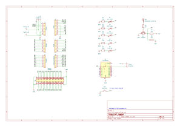

# EMF Reader

Arduino Mega–based detector for AC electric fields (50 Hz mains).
Field strength is displayed on 5 LEDs and an optional piezo buzzer.

## Schematic

[PDF version](docs/EMF_reader.pdf) · KiCad project in `hardware/`

## How it works
- Antenna → 2N3904 amplifier stage → A0
- Peak-to-peak amplitude per 100 ms window → level 1–5 (with hysteresis)
- Push button (pin 44) toggles the buzzer on/off

## Build
PlatformIO, board: Arduino Mega 2560
